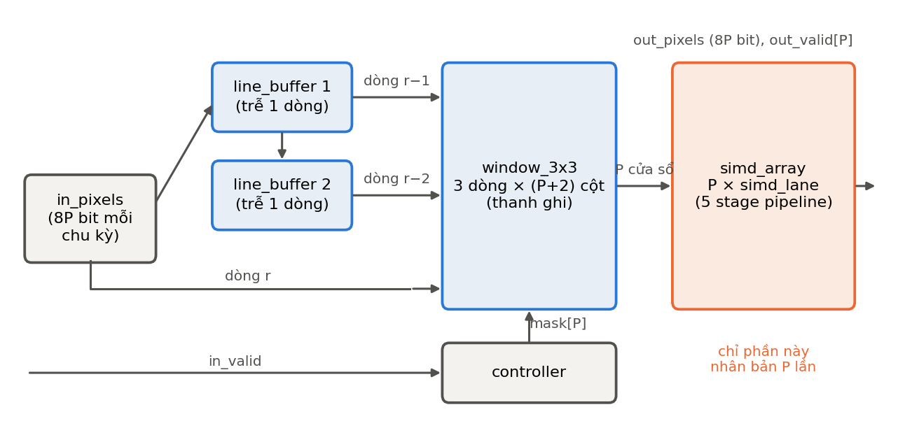
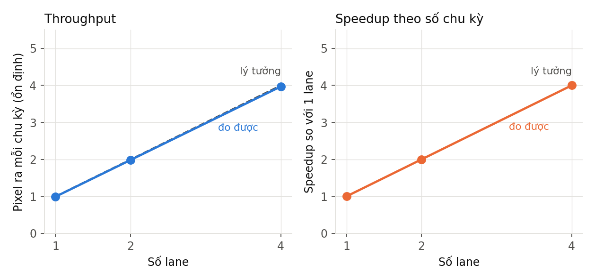
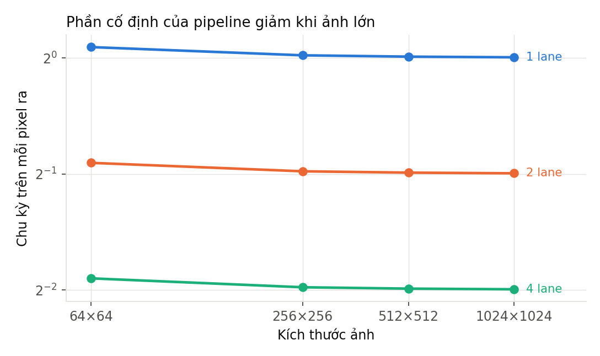
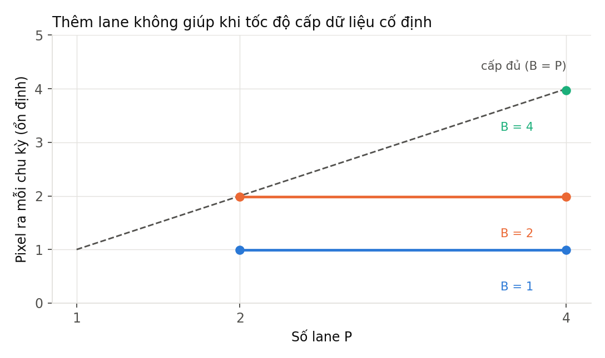
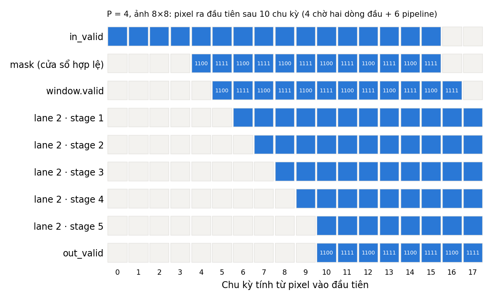
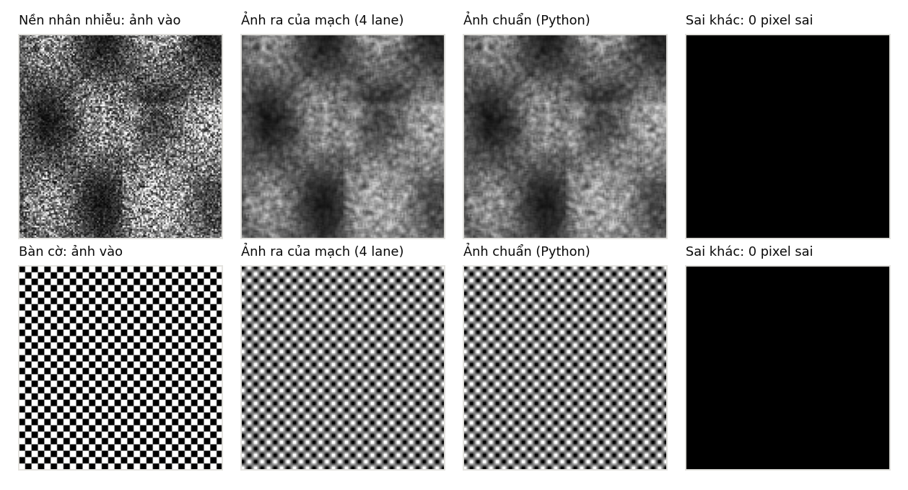
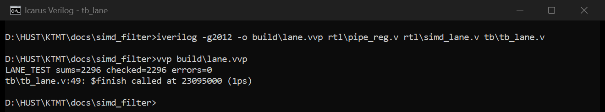
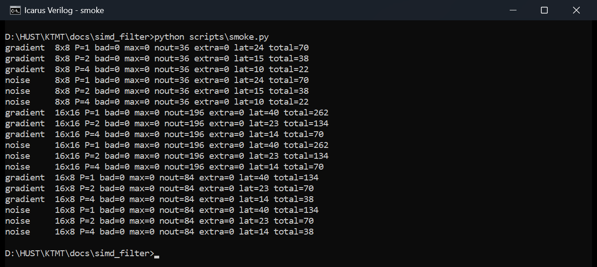
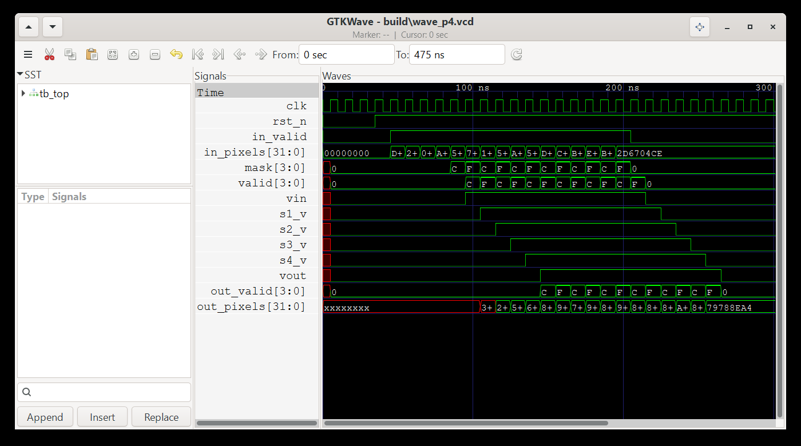

@chapter! Mở đầu

@section! Đặt vấn đề

Nhiều phép xử lý ảnh áp dụng cùng một thao tác lên rất nhiều cửa sổ ảnh độc lập, ví dụ làm mịn nhiễu bằng bộ lọc trung bình. Nếu một khối tính toán xử lý từng pixel lần lượt thì thời gian xử lý lớn; đặt nhiều khối giống nhau cạnh nhau để xử lý nhiều pixel trong một chu kỳ là ý tưởng song song dữ liệu (SIMD, Single Instruction Multiple Data). Mục 3.6 của giáo trình giới thiệu ý tưởng này qua song song hóa dữ liệu nhỏ trong một thanh ghi rộng [1], và đồ án thực hiện nó bằng phần cứng. Trong báo cáo này, "đa luồng" chỉ nhiều luồng dữ liệu được xử lý song song trên phần cứng (mỗi luồng là một lane, tức một bản sao khối tính toán xử lý một cửa sổ ảnh), không phải đa luồng phần mềm.

Câu hỏi trung tâm của đồ án: khi tăng số lane thì hiệu năng tăng đến đâu, và điều gì làm hiệu năng không tăng tuyến tính theo số lane.

@section! Mục tiêu đề tài

Mục tiêu cụ thể của đồ án gồm:

- Thiết kế bằng Verilog một lane thực hiện bộ lọc trung bình 3×3, vận dụng kiến thức số học máy tính (LN04).
- Chia lane thành các stage pipeline và phân tích tác dụng của pipeline (LN06).
- Tham số hóa số lane (1, 2 và 4) và kiểm chứng kết quả đúng ở mọi cấu hình bằng mô hình tham chiếu.
- Đo và giải thích hiệu năng bằng thời gian thực thi, speedup và định luật Amdahl (LN01).
- Phối hợp nhóm theo vai trò thiết kế, kiểm chứng và đánh giá (CLO3).

@section! Phạm vi và giới hạn

Phần lõi của đồ án dựa chủ yếu vào kiến thức đã học: bài giảng LN01 (hiệu năng), LN04 (số học máy tính), LN06 (CPU và pipeline) và các mục giáo trình được các bài giảng này liên kết tới [1], [2]. Phần mở rộng nhẹ gồm ba phần: nhân bản lane (SIMD, mục 3.6 của giáo trình), bộ đệm hai dòng ảnh để tạo cửa sổ 3×3 và một thí nghiệm về giới hạn cấp dữ liệu.

Đồ án không làm: đo chu kỳ xung nhịp của mạch thật, dùng ảnh thật, nhiều bộ lọc khác nhau, tập lệnh SIMD hay bộ giải mã lệnh. Vì vậy báo cáo không có số đo chu kỳ xung nhịp của mạch thật và mọi ảnh thử là ảnh mô phỏng; mọi so sánh hiệu năng được làm ở cùng chu kỳ xung nhịp theo số chu kỳ đo được trong mô phỏng.

@section! Phương pháp nghiên cứu

- **Thiết kế bằng Verilog:** mô tả bộ lọc trung bình 3×3 theo kiến trúc dòng dữ liệu, tham số hóa số lane P.
- **Kiểm chứng:** so sánh từng pixel với mô hình tham chiếu (chương trình Python và NumPy tính ảnh kết quả đúng); kiểm riêng lane bằng cách duyệt toàn bộ giá trị tổng có thể xảy ra.
- **Đo hiệu năng bằng mô phỏng:** đo số chu kỳ xử lý ảnh theo số lane, kích thước ảnh và số pixel cấp vào mỗi chu kỳ, bằng Icarus Verilog và testbench (mô-đun Verilog chỉ dùng để mô phỏng: cấp ảnh vào, thu kết quả và so với ảnh chuẩn).
- **Phân tích:** dùng công thức thời gian thực thi, speedup và Amdahl của LN01, và công thức pipeline của LN06 để giải thích số liệu.

@section! Tiến độ thực hiện

**Đã hoàn thành:**

- Mã Verilog cho 1, 2 và 4 lane, mô hình tham chiếu, testbench tự kiểm.
- Kiểm chứng tính đúng trên nhiều ảnh thử; thí nghiệm về số lane, kích thước ảnh và số pixel cấp vào mỗi chu kỳ.
- Phân tích hiệu năng theo LN01, phân tích pipeline theo LN06, dạng sóng và ảnh vào/ra.

**Còn lại:**

- Đọc chéo giữa các thành viên, chuẩn bị trả lời vấn đáp.
- Điền tên thành viên và hoàn thiện lời cảm ơn; chốt báo cáo cuối.

@section! Bố cục đồ án

Ngoài phần Mở đầu và Kết luận, nội dung đồ án được chia thành ba chương:

- **Chương 1: Cơ sở lý thuyết.** Trình bày hiệu năng và định luật Amdahl, số học máy tính, datapath và pipeline, và ý tưởng song song dữ liệu.
- **Chương 2: Thiết kế kiến trúc hệ thống.** Trình bày bài toán, kiến trúc tổng thể, bộ đệm hai dòng ảnh, datapath và pipeline của một lane, và mô hình số chu kỳ.
- **Chương 3: Thực nghiệm và kết quả.** Trình bày phương pháp kiểm chứng và đo, kết quả, thảo luận, hạn chế và hướng phát triển.

Trong báo cáo, "mục x.y" là mục của báo cáo; mục của giáo trình luôn được ghi là "của giáo trình".

@chapter Cơ sở lý thuyết

Chương này tóm tắt kiến thức của học phần được vận dụng trong đồ án, theo các bài giảng [2] và các mục giáo trình tương ứng [1].

Bảng: Kiến thức của học phần được vận dụng trong đồ án

| Bài giảng | Mục giáo trình | Nội dung | Dùng trong đồ án |
| --- | --- | --- | --- |
| LN01 | 1.6, 1.10 | Hiệu năng, thời gian thực thi, CPI, speedup, định luật Amdahl | Đo và giải thích hiệu năng theo số lane |
| LN04 | 3.1 đến 3.4, B.4 | Cộng, nhân, chia; ALU bằng Verilog | Cây cộng 9 pixel; chia 9 bằng nhân hằng số |
| LN06 | 4.2, 4.5, B.1 đến B.5 | Datapath, quy ước xung nhịp, pipeline | Pipeline của lane |
| Giáo trình | 3.6 | Song song dữ liệu trên dữ liệu nhỏ | Nhân bản lane |

@section Hiệu năng máy tính

Hiệu năng của máy X tỷ lệ nghịch với thời gian thực thi CPU của nó (LN01). Thời gian thực thi của một chương trình được tính theo số lệnh, số chu kỳ trung bình trên mỗi lệnh (CPI) và chu kỳ xung nhịp:

$$CPU\ time = Instructions \times CPI \times Clock\ cycle\ time$$

Công thức tương đương là Performance = Clock rate/(Instructions × CPI). Speedup của máy A so với máy B bằng Performance_A/Performance_B, tức là thời gian của máy B chia cho thời gian của máy A trên cùng một công việc. Cần chú ý rằng số chu kỳ thấp hơn chưa chắc là nhanh hơn nếu chu kỳ xung nhịp dài hơn. Bài giảng minh họa bằng ví dụ hai máy cùng tập lệnh: máy A có chu kỳ 1 ns và CPI 2,0, máy B có chu kỳ 2 ns và CPI 1,2. Với cùng số lệnh I, thời gian của A là 2,0·I ns, của B là 2,4·I ns, nên A nhanh hơn B 1,2 lần dù CPI của B thấp hơn.

Đồ án không có tập lệnh nên không dùng CPI theo nghĩa số lệnh. Công việc ở đây là xử lý các pixel ảnh, và đại lượng tương ứng là số chu kỳ trên mỗi pixel ra. Thời gian xử lý một ảnh là:

$$Time = Pixels \times \frac{Cycles}{Pixel} \times Clock\ cycle\ time$$

Định luật Amdahl cho cận trên của speedup khi chỉ tăng tốc một phần của công việc. Nếu f là phần không được tăng tốc và p là hệ số tăng tốc của phần còn lại:

$$s = \frac{1}{f + \frac{1-f}{p}}, \qquad s \le \min\left(p, \frac{1}{f}\right)$$

Trong đồ án, p là số lane; phần f gồm thời gian làm đầy pipeline và các đoạn không song song hóa được.

@section Số học máy tính

Pixel ảnh xám 8 bit là số nguyên không dấu từ 0 đến 255 (LN04). Phép cộng được thực hiện từng bit từ phải sang trái, carry truyền sang bit kế tiếp; cộng hai số n bit cho kết quả tối đa n + 1 bit, nên độ rộng bit tăng dần qua mỗi tầng cộng. Tổng của 9 pixel lớn nhất là 9 × 255 = 2295, nhỏ hơn 4096 nên cần 12 bit.

Phép nhân bằng phần cứng là dịch và cộng: mỗi bit của số nhân quyết định có cộng số bị nhân đã dịch vào tích hay không; thuật toán Booth mở rộng cho số có dấu. Phép chia bằng phần cứng lặp lại các bước trừ ước số khỏi phần dư rồi dịch, với số bước tỷ lệ với số bit, nên chậm và tốn nhiều chu kỳ. Vì vậy đồ án chia cho 9 bằng một phép nhân với hằng số rồi dịch bit, thay cho bộ chia (mục 2.4).

Ngôn ngữ mô tả phần cứng Verilog (mục B.4, B.5 của giáo trình) cho phép mô tả bộ cộng, ALU và các mạch tổ hợp bằng các phép gán; đồ án dùng cách mô tả này.

@section Datapath, xung nhịp và pipeline

Một CPU gồm datapath (các khối xử lý và lưu trữ như thanh ghi, ALU, bộ ghép kênh) và các tín hiệu điều khiển chọn đường đi dữ liệu (LN06, mục 4.2 của giáo trình). Các phần tử trạng thái được cập nhật theo cạnh của xung nhịp, nên chu kỳ xung nhịp phải đủ dài để tín hiệu đi hết phần mạch tổ hợp giữa hai phần tử trạng thái.

Pipeline là kỹ thuật cho nhiều công việc chồng lấp nhau trong lúc thực thi (mục 4.5 của giáo trình): chia công việc thành các stage, mỗi stage một phần việc, và nhiều công việc nằm ở các stage khác nhau trong cùng một chu kỳ. Nếu các stage cân bằng thì thời gian giữa hai kết quả liên tiếp, trong điều kiện lý tưởng, là:

$$T = \frac{Time\ between\ instructions_{nonpipelined}}{Number\ of\ pipe\ stages}$$

Pipeline làm tăng số công việc hoàn thành mỗi đơn vị thời gian chứ không làm một công việc riêng lẻ xong sớm hơn; thanh ghi giữa các stage còn làm thêm độ trễ, tức là thời gian từ lúc một công việc bắt đầu đến lúc nó xong. Giáo trình nêu các tình huống (hazard) làm pipeline không chạy đầy (mục 4.5 của giáo trình); trong đồ án, lane không gặp tình huống này vì các pixel độc lập nhau, không có lệnh rẽ nhánh và mỗi stage dùng bộ cộng riêng.

@section Song song dữ liệu

Song song dữ liệu là áp dụng cùng một thao tác lên nhiều phần tử dữ liệu trong cùng một chu kỳ. Mục 3.6 của giáo trình trình bày ý tưởng này trên số học: nhiều dữ liệu nhỏ (ví dụ 8 bit) được xử lý song song [1]. Đồ án áp dụng ý tưởng tương tự bằng cách nhân bản khối tính toán thay vì chia bộ cộng: P lane giống hệt nhau cùng xử lý P cửa sổ ảnh. Cần P pixel mới mỗi chu kỳ, nên số pixel mà nguồn cấp được mỗi chu kỳ (gọi là tốc độ cấp dữ liệu, ký hiệu B) ảnh hưởng đến hiệu năng (mục 3.5 của báo cáo). Theo định luật Amdahl, phần việc nguồn không cấp kịp là phần không được tăng tốc khi thêm lane, với p là số lane P.

@chapter Thiết kế kiến trúc hệ thống

@section Bài toán và quy ước biên

Bộ lọc trung bình 3×3 thay mỗi pixel bằng phần nguyên của trung bình 9 pixel trong cửa sổ 3×3 quanh nó. Nhóm chỉ xuất các pixel có đủ 8 lân cận, nên ảnh ra có kích thước (W − 2) × (H − 2) với ảnh vào W × H; mô hình tham chiếu dùng cùng quy ước. Hệ quả là mỗi dòng có hai vị trí biên không có pixel ra, nên throughput ổn định, tức số pixel ra mỗi chu kỳ khi pipeline đã đầy, bằng P·(W − 2)/W chứ không đúng bằng P (mục 3.3).

@section Kiến trúc tổng thể

Mỗi chu kỳ hệ thống nhận một "từ" gồm P pixel liên tiếp của dòng ảnh hiện tại. Hai bộ đệm dòng (mục 2.3) cho ra các pixel cùng cột của hai dòng trước, nên mỗi chu kỳ có đủ ba dòng. Cửa sổ 3 dòng × (P + 2) cột giữ hai pixel cuối của từ trước và P pixel của từ hiện tại, từ đó cắt ra P cửa sổ chồng lấp; hai cột được dùng chung giữa các cửa sổ kề nhau nên mỗi pixel chỉ cần đọc một lần. P lane giống hệt nhau, mỗi lane xử lý một cửa sổ. Mỗi lane có một tín hiệu điều khiển 1 bit, gọi là valid, đi kèm dữ liệu qua các stage để báo kết quả có hợp lệ hay không; các pixel hợp lệ theo thứ tự lane và thời gian tạo thành ảnh ra theo thứ tự từng dòng, từ trái sang phải.

Chỉ phần lane được nhân bản P lần; cửa sổ rộng hơn (P + 2 cột) và đường vào rộng 8P bit khi P tăng.
Bảng: Các module Verilog của hệ thống

| Module | Chức năng |
| --- | --- |
| line\_buffer.v | Trễ một dòng ảnh (W/P từ) |
| window\_3x3.v | Thanh ghi cửa sổ 3 dòng × (P+2) cột và tín hiệu hợp lệ |
| simd\_lane.v | Cây cộng 9 pixel, chuẩn hóa; pipeline 5 stage |
| simd\_array.v | Nhân bản P lane, cắt cửa sổ cho từng lane |
| pipe\_reg.v | Thanh ghi pipeline, tín hiệu hợp lệ đi kèm dữ liệu |
| controller.v | Đếm vị trí từ vào, tạo tín hiệu hợp lệ cho P cửa sổ |
| top.v | Ghép hệ thống; tham số P, W, H; W chia hết cho P |

Bảng: Cấu trúc theo số lane

| Số lane P | Pixel vào mỗi chu kỳ | Pixel trong cửa sổ | Bộ cộng | Pixel cửa sổ trên mỗi pixel ra |
| --- | --- | --- | --- | --- |
| 1 | 1 | 9 | 8 | 9 |
| 2 | 2 | 12 | 16 | 6 |
| 4 | 4 | 18 | 32 | 4,5 |

Số bộ cộng tăng tuyến tính theo P, còn số pixel cửa sổ trên mỗi pixel ra giảm vì các cột được dùng chung.

@section Bộ đệm hai dòng ảnh

Để tính một pixel ra cần 9 pixel của ba dòng ảnh liên tiếp. Nếu mỗi cửa sổ đọc lại cả 9 pixel từ nguồn thì cần 9 pixel mới mỗi chu kỳ cho mỗi pixel ra, gấp 9 lần số pixel ra. Bộ đệm dòng (line buffer) tránh việc này: đó là một bộ nhớ trễ đúng một dòng ảnh, dài W/P từ, hoạt động như phần tử trạng thái cập nhật theo xung nhịp (mục 1.3). Hai bộ nối tiếp giữ hai dòng ảnh trước, nên nguồn chỉ cần cấp dòng hiện tại và mỗi pixel chỉ được cấp một lần. Dung lượng hai bộ là 2 × W × 8 bit, không đổi theo P.

Hệ quả với hiệu năng là hệ thống cần đúng P pixel mới mỗi chu kỳ, nên tốc độ cấp dữ liệu là điều kiện để các lane chạy hết khả năng (mục 3.5).

@section Datapath của một lane

Một lane nhận 9 pixel 8 bit và cho ra một pixel 8 bit. Cây cộng có 4 tầng và 8 bộ cộng; độ rộng kết quả tăng dần từ 9 đến 12 bit (mục 1.2). Pixel thứ chín đi thẳng qua các tầng đầu và được cộng ở tầng sau vì 9 là số lẻ.

Bảng: Các stage của một lane

| Stage | Phép tính | Bộ cộng | Độ rộng | Bit thanh ghi |
| --- | --- | --- | --- | --- |
| 1 | 4 phép cộng cặp, pixel thứ 9 đi thẳng | 4 | 9 bit | 45 |
| 2 | 2 phép cộng | 2 | 10 bit | 30 |
| 3 | 1 phép cộng | 1 | 11 bit | 22 |
| 4 | 1 phép cộng tạo tổng cuối | 1 | 12 bit | 12 |
| 5 | Chuẩn hóa | 0 (một bộ nhân hằng số) | 8 bit | 8 |

Phép chia cho 9 được thực hiện bằng nhân hằng số rồi dịch bit, thay cho bộ chia ở LN04:

$$y = (x \times 7282) \gg 16 = \lfloor x / 9 \rfloor$$

Stage chuẩn hóa đổi tổng thành trung bình bằng cách chia cho 9; hằng số 7282 xấp xỉ 65536/9, nên với tổng x từ 0 đến 2295 kết quả bằng phần nguyên của x/9. Tính đúng của phép tính này được kiểm chứng bằng cách duyệt toàn bộ 2296 giá trị tổng (mục 3.1). Phép nhân hằng số được đặt trong một stage, khác với bộ chia lặp cần nhiều chu kỳ; độ trễ mạch của stage này chưa đo được (mục 2.5).

@section Pipeline của lane

Mỗi tầng cộng được đặt ở một stage, cộng thêm một stage chuẩn hóa, tổng cộng 5 stage; tín hiệu hợp lệ đi kèm dữ liệu qua mọi stage. Cộng thêm một thanh ghi cửa sổ phía trước, độ sâu pipeline từ pixel vào tới pixel ra là D = 6 chu kỳ. Để thấy tác dụng của pipeline, bảng dưới so sánh lane 5 stage đã cài đặt với một lane không pipeline giả định (chỉ để phân tích, chưa cài đặt), theo công thức của LN06.

Bảng: So sánh lane không pipeline (giả định) và lane 5 stage (đã cài đặt)

| Tiêu chí | Lane không pipeline | Lane 5 stage |
| --- | --- | --- |
| Phép tính nối tiếp trong một chu kỳ | 4 phép cộng rồi 1 phép nhân hằng số | Tối đa 1 phép cộng hoặc 1 phép nhân hằng số |
| Chu kỳ xung nhịp | Dài: bằng tổng độ trễ các phép tính | Ngắn: bằng độ trễ của stage chậm nhất |
| Kết quả ra khi đã đầy | 1 pixel mỗi chu kỳ | 1 pixel mỗi chu kỳ |
| Độ sâu D | Khoảng 2 chu kỳ (ước tính) | 6 chu kỳ (đo) |

Theo công thức của LN06, nếu 5 stage cân bằng hoàn hảo thì chu kỳ xung nhịp giảm tối đa 5 lần so với lane không pipeline. Thực tế các stage chưa cân bằng: stage chuẩn hóa chứa một phép nhân hằng số có thể chậm hơn một phép cộng, nên hệ số giảm thực tế nhỏ hơn 5. Nhóm không đo được hệ số này vì không có số liệu độ trễ mạch. Chi phí của pipeline ước tính là thêm khoảng bốn chu kỳ độ trễ (tính theo số chu kỳ, chưa quy ra thời gian), không đáng kể so với W·H/P chu kỳ của một ảnh (mục 3.4).

@section Mô hình số chu kỳ

Với ảnh W × H, P lane và D = 6 là độ sâu pipeline, tổng số chu kỳ xử lý bằng thời gian nhận ảnh cộng độ sâu pipeline. Độ trễ đến pixel ra đầu tiên gồm thời gian nhận hai dòng ảnh đầu, một số từ để cửa sổ đầu tiên đủ ba cột, và D. Hai công thức này được so với số đo ở mục 3.3 và 3.4:

$$T_P = \left\lceil \frac{W \cdot H}{P} \right\rceil + D, \qquad L_P = \frac{2W}{P} + \left(\left\lceil \frac{3}{P} \right\rceil - 1\right) + D$$

@chapter Thực nghiệm và kết quả

@section Phương pháp kiểm chứng và đo

Mô hình tham chiếu viết bằng Python và NumPy: tính tổng cửa sổ 3×3, chia nguyên cho 9, chỉ giữ pixel đủ 8 lân cận. Testbench Verilog nạp ảnh, cấp P pixel mỗi chu kỳ, thu pixel ra, tự so với ảnh chuẩn và ghi file; Python so lại độc lập từ file. Khâu chuẩn hóa của lane được kiểm riêng bằng testbench duyệt toàn bộ 2296 giá trị tổng.

Ảnh thử gồm gradient, bàn cờ, nhiễu ngẫu nhiên (hạt giống cố định 2026), toàn 0, toàn 255, ảnh không vuông 48×20 và ảnh nền nhân nhiễu mô phỏng (nền có cấu trúc nhân với nhiễu ngẫu nhiên, tạo bằng chương trình, không phải ảnh thật). Công cụ: Icarus Verilog 14.0 [3] (kèm GTKWave để xem dạng sóng), Python 3.12.9, NumPy 2.3.4 [4], Matplotlib 3.10.6 [5]. Các chỉ số đo gồm:

- **Độ trễ:** số chu kỳ từ pixel vào đầu tiên đến pixel ra đầu tiên.
- **Tổng chu kỳ:** từ pixel vào đầu tiên đến pixel ra cuối cùng.
- **Throughput ổn định:** số pixel ra chia số chu kỳ giữa pixel ra đầu và cuối.
- **Chu kỳ trên pixel:** tổng chu kỳ chia số pixel ra; đóng vai CPI của LN01.
- **Speedup:** tỷ số tổng chu kỳ so với 1 lane ở cùng chu kỳ xung nhịp, và hiệu suất song song là speedup chia số lane (đạt 100% khi speedup bằng cận s ≤ p của định luật Amdahl).

@section Tính đúng đắn

Bảng: Kết quả kiểm chứng tính đúng đắn theo số lane

{{T:5.1}}

Mỗi cấu hình lane được kiểm tra trên 153.752 pixel ra, không có pixel sai, thừa hay thiếu; testbench tự kiểm cũng báo không lỗi. Ngoài ra nhóm kiểm thêm các điều kiện khó (nguồn dữ liệu bị ngắt quãng ngẫu nhiên, nhiều khung ảnh liên tiếp) và chèn có chủ đích 5 lỗi vào mã Verilog để chắc bộ kiểm tra phát hiện được lỗi; tổng cộng 49 lần chạy kiểm chứng (30 lần ở các ảnh thử và 19 lần ở điều kiện ngắt quãng, nhiều khung; không tính 5 lần chèn lỗi), 584.264 pixel, không pixel sai. Chi tiết ở Phụ lục A.

@section Hiệu năng theo số lane

Ảnh 256×256, cùng bộ lọc và cùng dữ liệu cho mọi cấu hình, nguồn cấp đủ P pixel mỗi chu kỳ.

Bảng: Hiệu năng theo số lane (ảnh 256×256)

{{T:5.2}}

Tổng số chu kỳ khớp mô hình T_P ở mọi cấu hình. Chu kỳ trên pixel giảm gần đúng theo 1/P (1,016, 0,508, 0,254), nên ở cùng chu kỳ xung nhịp, theo công thức thời gian của LN01, speedup bằng tỷ số số chu kỳ: 2,000 lần với 2 lane và 3,999 lần với 4 lane, tức hiệu suất song song gần 100%. Throughput ổn định thấp hơn P một chút (3,969 so với 4) khớp hệ số (W − 2)/W của biên ảnh tới chữ số thập phân thứ ba. Độ trễ giảm khi P tăng (520, 263, 134 chu kỳ) vì hai dòng ảnh đầu được nhận nhanh hơn.

@section Ảnh hưởng của kích thước ảnh

Bảng: Số chu kỳ và chu kỳ trên pixel theo kích thước ảnh
Bảng: Speedup so với 1 lane theo kích thước ảnh

{{T:5.3}}

Phần không tăng tốc được là thời gian làm đầy pipeline, D = 6 chu kỳ, nên trong công thức Amdahl f ≈ 6/(W·H) rất nhỏ và cận 1/f không phải giới hạn ở đây. Ảnh càng lớn thì f càng nhỏ: ở ảnh 64×64, 4 lane đạt speedup 3,983; ở 1024×1024 là 4,000. Ảnh 64×64 vì vậy chỉ phù hợp để gỡ lỗi.

@section Giới hạn tốc độ cấp dữ liệu

Thí nghiệm này chỉ cấp B pixel mỗi chu kỳ (B nhỏ hơn hoặc bằng P) và đo xem thêm lane có còn giúp được không. Trong cách nhìn của Amdahl, khả năng cấp dữ liệu là phần không được tăng tốc khi thêm lane.

Bảng: Throughput khi giới hạn tốc độ cấp dữ liệu (ảnh 256×256)

{{T:5.4}}

Throughput ổn định xấp xỉ B·(W − 2)/W khi B nhỏ hơn P và không phụ thuộc số lane: với B = 1, cả 2 và 4 lane đều chỉ đạt 0,992 pixel/chu kỳ. Có thể viết gọn throughput ≈ min(B, P)·(W − 2)/W: thêm lane chỉ có ích khi nguồn cấp được tương ứng.

@section Minh họa

Dạng sóng mô phỏng thật (ảnh 8×8, P = 4): cửa sổ hợp lệ đầu tiên xuất hiện sau thời gian nhận hai dòng ảnh đầu (4 chu kỳ), đi qua thanh ghi cửa sổ và 5 stage của lane rồi ra sau 10 chu kỳ, khớp mô hình độ trễ.

Ảnh vào, ảnh ra của mạch 4 lane, ảnh chuẩn Python và sai khác (ảnh 128×128):

Để kết quả kiểm tra được trên chính công cụ mô phỏng, nhóm chạy lại các testbench bằng Icarus Verilog rồi chụp màn hình cửa sổ đang chạy. Các hình dưới đây là ảnh chụp thật, không phải đồ họa vẽ lại. Ở hình đầu tiên, lệnh iverilog biên dịch `pipe_reg.v`, `simd_lane.v` và `tb_lane.v`, rồi lệnh vvp chạy testbench và in `LANE_TEST sums=2296 checked=2296 errors=0`. Như vậy cả 2296 giá trị tổng đều cho kết quả chuẩn hóa đúng.

Hình thứ hai là kết quả của `scripts/smoke.py`, chạy hệ thống đầy đủ với ảnh 8×8, 16×16 và 16×8 ở 1, 2 và 4 lane. Cả 18 dòng đều báo `bad=0`. Với ảnh 8×8, tổng chu kỳ là 70, 38 và 22 ở 1, 2 và 4 lane, đúng bằng ⌈W·H/P⌉ + 6 tính được là 64 + 6, 32 + 6 và 16 + 6. Độ trễ đo được là 24, 15 và 10 chu kỳ, cũng khớp công thức L_P ở mục 2.6.

Hình cuối là dạng sóng của ảnh 8×8 với 4 lane, mở bằng GTKWave từ file VCD (ghi giá trị các tín hiệu theo thời gian) do testbench ghi. Cửa sổ hợp lệ (mask) xuất hiện sau khi nhận hai dòng ảnh đầu. Các tín hiệu hợp lệ của lane 2 (`vin`, `s1_v` đến `s4_v` và `vout`) lên chậm hơn tín hiệu đứng trước đúng một chu kỳ, và `out_valid` lên sau pixel vào đầu tiên 10 chu kỳ, bằng L₄ = 4 + 0 + 6 = 10.

@section Thảo luận

**Vì sao speedup gần lý tưởng.** Mô phỏng dùng nguồn dữ liệu lý tưởng và phần cố định chỉ 6 chu kỳ, nên speedup theo số chu kỳ gần bằng số lane. Đây là cận trên của kiến trúc, không phải hiệu năng trên phần cứng thật.

**Điểm đánh đổi.**

- Số lane và chi phí: số bộ cộng tăng tuyến tính theo số lane (8, 16, 32 bộ cộng) để đổi lấy throughput tăng gần tuyến tính.
- Số lane và cấp dữ liệu: P lane cần 8P bit dữ liệu mới mỗi chu kỳ; thiếu thì throughput bằng B.
- Pipeline và độ trễ: chia lane thành 5 stage làm chu kỳ xung nhịp có thể ngắn hơn nhưng thêm khoảng bốn chu kỳ độ trễ (ước tính, chưa quy ra thời gian).

**Chu kỳ xung nhịp.** Số chu kỳ chỉ là một nửa của công thức thời gian. Ví dụ minh họa theo cách của bài giảng (giả định, không phải số đo): nếu cấu hình 4 lane phải dùng chu kỳ xung nhịp dài hơn 1 lane 25% vì nhiều logic hơn, thời gian trên mỗi pixel là 1,016·T cho 1 lane và 0,254 × 1,25·T = 0,3175·T cho 4 lane, nên speedup theo thời gian là khoảng 3,2 thay vì 3,999. 4 lane chỉ chậm hơn 1 lane khi chu kỳ xung nhịp dài hơn khoảng 4 lần. Muốn có con số thật phải đo chu kỳ xung nhịp của mạch thật, việc nhóm chưa làm.

**Cấu hình nên chọn.** Nên chọn số lane khớp với tốc độ cấp dữ liệu có thể có: dư lane không tăng throughput mà chỉ tốn thêm bộ cộng và thanh ghi.

@section Hạn chế và hướng phát triển

**Hạn chế**

- Chỉ mô phỏng; chưa có số đo chu kỳ xung nhịp và tài nguyên phần cứng của mạch thật. Chi phí chỉ được thể hiện bằng số bộ cộng đếm từ thiết kế (Bảng 2.2).
- Mọi ảnh thử là ảnh mô phỏng; chỉ có một bộ lọc; chiều rộng ảnh phải chia hết cho số lane.
- Nguồn dữ liệu và bộ nhớ trong mô phỏng là lý tưởng.

**Hướng phát triển**

- Đo chu kỳ xung nhịp của mạch thật (cần công cụ ngoài phạm vi học phần), thay cho ví dụ giả định ở mục 3.7.
- Thử pipeline sâu hơn hoặc nông hơn và nhiều độ rộng bit.
- Dùng ảnh thật và mở rộng số lane (mã Verilog đã tham số hóa; cấu hình 8 lane đã chạy thử trong thư mục kết quả nhưng không đưa vào báo cáo).

@chapter! Kết luận

Bộ lọc trung bình 3×3 theo kiến trúc SIMD đa lane hoạt động đúng ở 1, 2 và 4 lane trên mọi ảnh thử. Vận dụng kiến thức của học phần, nhóm dùng cây cộng có độ rộng tăng dần và phép chia 9 bằng nhân hằng số (LN04), chia lane thành 5 stage pipeline (LN06), và dùng công thức thời gian, speedup và Amdahl (LN01) để đo và giải thích hiệu năng. Số chu kỳ khớp mô hình toán học do nhóm dẫn xuất; ở cùng chu kỳ xung nhịp, throughput tăng gần tuyến tính theo số lane (3,969 pixel/chu kỳ và speedup 3,999 lần ở 4 lane). Điểm đánh đổi rõ nhất trong mô phỏng là tốc độ cấp dữ liệu: thêm lane vượt quá B không làm tăng throughput.

Tiêu chí thành công của đồ án:

- [x] 1 lane xử lý đúng bộ lọc và khớp mô hình tham chiếu (mục 3.2).
- [x] 2 và 4 lane cho kết quả đúng (mục 3.2).
- [x] Có số liệu cho thấy throughput tăng khi tăng số lane (mục 3.3).
- [x] Giải thích hiệu năng bằng thời gian thực thi, speedup và Amdahl (mục 3.3, 3.4).
- [x] Nêu được các điểm đánh đổi giữa pipeline, số lane và tốc độ cấp dữ liệu (mục 3.5, 3.7).

Việc còn lại: đọc chéo giữa các thành viên, chuẩn bị vấn đáp, điền tên thành viên và chốt báo cáo.

@chapter! Tài liệu tham khảo

@ref D. A. Patterson and J. L. Hennessy, <em>Computer Organization and Design: The Hardware/Software Interface</em>, 5th ed. Elsevier, 2014.
@ref Nguyễn Đình Hân, <em>Bài giảng MI4344 Kiến trúc máy tính: LN00 đến LN06</em>. FaMI-HUST, Đại học Bách khoa Hà Nội, 2026.
@ref Icarus Verilog, "Icarus Verilog," http://iverilog.icarus.com, version 14.0 (devel).
@ref C. R. Harris et al., "Array programming with NumPy," <em>Nature</em>, vol. 585, pp. 357–362, 2020.
@ref J. D. Hunter, "Matplotlib: A 2D graphics environment," <em>Computing in Science &amp; Engineering</em>, vol. 9, no. 3, pp. 90–95, 2007.

@chapter! Phụ lục

@apphead A | Kết quả bổ sung

@appsec Kết quả theo từng ảnh

Bảng: Số pixel sai theo từng ảnh thử

{{T:5.1b}}

@appsec Kiểm chứng bổ sung

Ngoài các ảnh thử ở mục 3.2, nhóm kiểm thêm hai điều kiện khó và chèn lỗi có chủ đích. Nguồn dữ liệu bị ngắt quãng ngẫu nhiên với xác suất 30% và 70% mỗi chu kỳ, và ba khung ảnh liên tiếp không đặt lại về trạng thái đầu giữa các khung, nhằm chắc tín hiệu hợp lệ và bộ đếm dòng cột hoạt động đúng khi nguồn không đều.

Bảng: Kết quả kiểm chứng khi nguồn dữ liệu bị ngắt quãng và nhiều khung ảnh

{{T:5.7}}

Bảng: Kết quả phép thử đối chứng

{{T:5.7b}}

@apphead B | Mã nguồn chương trình

Toàn bộ mã nằm trong kho mã (repository) đính kèm; báo cáo chỉ in lại lane vì đây là phần cốt lõi.

Bảng: Cấu trúc thư mục mã nguồn

| Thư mục | Nội dung |
| --- | --- |
| `rtl/` | 7 module Verilog (mục 2.2) |
| `tb/` | `tb_lane.v`, `tb_top.v` |
| `scripts/` | `simd_sim.py` (mô hình tham chiếu, sinh ảnh, chạy mô phỏng), `run_experiments.py`, `make_figures.py`, `make_demo.py`, `make_architecture.py`, `test_lane.py`, `smoke.py`, `make_wave_vcd.py`, `build_thesis.py` |
| `results/` | Kết quả thô (json) và bảng đã sinh |
| `figures/` | Các đồ thị trong báo cáo |

Kiểm tra nhanh: `python scripts/test_lane.py` (kiểm một lane) và `python scripts/smoke.py` (toàn hệ thống, ảnh nhỏ). Chạy lại các thí nghiệm: `python scripts/run_experiments.py`, rồi `python scripts/make_figures.py` và `python scripts/make_demo.py` (chạy ở thư mục gốc của kho mã, cần Icarus Verilog, Python, NumPy, Matplotlib; xem `README.md`).

@appsec Mã nguồn simd_lane.v

{{CODE:rtl/simd_lane.v}}

@apphead C | Phân công nhóm

Nhóm có 4 thành viên. Mỗi thành viên chịu trách nhiệm hiểu, giải thích và bảo vệ phần mình sở hữu, đồng thời hoàn thành các việc còn lại ghi dưới đây.

@appsec Phân vai

Bảng: Phân vai trong nhóm

| Vai | Thành viên | Sở hữu | Phần báo cáo phụ trách |
| --- | --- | --- | --- |
| 1. Số học và lane | \[họ tên\] | `simd_lane.v`, `pipe_reg.v`, `tb_lane.v` | 1.2, 2.4, 2.5 |
| 2. Datapath vào và mảng SIMD | \[họ tên\] | `line_buffer.v`, `window_3x3.v`, `controller.v`, `simd_array.v`, `top.v` | 2.2, 2.3, 2.6, 3.3 đến 3.5 |
| 3. Kiểm chứng và dữ liệu | \[họ tên\] | `tb_top.v`, `simd_sim.py`, `run_experiments.py` | 3.1, 3.2, 3.6, Phụ lục A |
| 4. Đánh giá hiệu năng và tổng hợp | \[họ tên\] | `make_figures.py`, `make_demo.py`, báo cáo | 1.1, 1.3, 3.7, 3.8, Kết luận |

@appsec Vai 1. Số học và lane

Mục tiêu: hiểu và giải thích được lane tính đúng bằng kiến thức số học (LN04) và pipeline (LN06).

- [ ] Giải thích cây cộng 4 tầng, độ rộng 9 đến 12 bit và vì sao tổng cần 12 bit.
- [ ] Giải thích phép chuẩn hóa (x × 7282) &gt;&gt; 16 và đối chiếu với kết quả duyệt toàn bộ 2296 giá trị tổng của `tb_lane.v`.
- [ ] So sánh nhân hằng số với phần cứng chia ở LN04: số bước, khả năng đặt trong một stage.
- [ ] Giải thích vì sao mỗi stage chỉ có một phép tính và vì sao lane không gặp tình huống làm pipeline không chạy đầy (hazard).
- [ ] Hoàn thiện mục 1.2, 2.4 và 2.5.

Sản phẩm: các mục trên và phần trình bày về lane (khoảng 5 phút). Tiêu chí hoàn thành: trả lời được vì sao tổng cần 12 bit, vì sao dùng nhân hằng số thay cho bộ chia, và pipeline tăng lợi ích gì, tốn gì.

@appsec Vai 2. Datapath vào và mảng SIMD

Mục tiêu: giải thích được đường đi của dữ liệu từ đầu vào đến lane và vì sao số chu kỳ đo được khớp mô hình.

- [ ] Giải thích bộ đệm dòng, cửa sổ rộng P + 2 cột và bộ điều khiển tạo tín hiệu hợp lệ cho từng cửa sổ.
- [ ] Tự dẫn xuất T_P và L_P; giải thích hệ số (W − 2)/W của throughput ổn định.
- [ ] Chạy lại thí nghiệm về số lane, kích thước ảnh và tốc độ cấp dữ liệu bằng `run_experiments.py` và xác nhận số liệu mục 3.3 đến 3.5 không đổi.
- [ ] Giải thích thí nghiệm giới hạn cấp dữ liệu theo cách nhìn Amdahl.
- [ ] Hoàn thiện mục 2.2, 2.3, 2.6 và 3.3 đến 3.5.

Sản phẩm: các mục trên và phần trình bày về luồng dữ liệu. Tiêu chí hoàn thành: giải thích được vì sao pixel ra đầu tiên xuất hiện sau 10 chu kỳ trong dạng sóng ảnh 8×8 với P = 4.

@appsec Vai 3. Kiểm chứng và dữ liệu

Mục tiêu: kiểm tra kết quả đúng và đảm bảo số liệu truy được.

- [ ] Giải thích mô hình tham chiếu và hai bộ so sánh độc lập (testbench tự kiểm và Python).
- [ ] Giải thích bộ ảnh thử và vì sao chọn từng loại.
- [ ] Giải thích kiểm chứng bổ sung ở Phụ lục A và phép thử đối chứng.
- [ ] Giải thích định nghĩa các chỉ số (độ trễ, tổng chu kỳ, throughput ổn định) và cách testbench đo chúng.
- [ ] Hoàn thiện mục 3.1, 3.2, 3.6 và Phụ lục A; kiểm tra số liệu trong báo cáo khớp các file kết quả.

Sản phẩm: các mục trên và phần trình bày về kiểm chứng. Tiêu chí hoàn thành: trả lời được vì sao cần hai bộ so sánh độc lập và vì sao con số không pixel sai chưa chứng minh thiết kế đúng tuyệt đối.

@appsec Vai 4. Đánh giá hiệu năng và tổng hợp

Mục tiêu: vận dụng LN01 để đánh giá và kết luận, đồng thời tổng hợp báo cáo.

- [ ] Giải thích công thức thời gian thực thi, CPI và speedup của LN01 và cách đồ án đổi chu kỳ trên pixel thành đại lượng tương ứng CPI.
- [ ] Giải thích định luật Amdahl và áp dụng cho phần cố định là thời gian làm đầy pipeline.
- [ ] Giải thích bảng so sánh lane không pipeline và lane 5 stage, và ví dụ minh họa chu kỳ xung nhịp ở mục 3.7.
- [ ] Hoàn thiện mục 1.1, 1.3, 3.7, 3.8 và Kết luận; ghép và xuất báo cáo cuối.

Sản phẩm: các mục trên và phần trình bày về đánh giá hiệu năng. Tiêu chí hoàn thành: trả lời được vì sao số chu kỳ thấp chưa chắc là nhanh hơn, và vì sao speedup gần lý tưởng ở ảnh lớn.

@appsec Phối hợp chung

Đọc chéo để mỗi người hiểu cả hệ thống, không chỉ phần của mình:

Bảng: Lịch đọc chéo giữa các thành viên

| Người đọc | Đọc và hỏi lại | Câu hỏi mẫu |
| --- | --- | --- |
| Vai 1 | Mã vai 2 (`line_buffer`, `window_3x3`, `controller`) | Vì sao cửa sổ cần P+2 cột? |
| Vai 2 | Testbench và script vai 3 | Vì sao cần hai bộ so sánh độc lập? |
| Vai 3 | Mã lane của vai 1 | Vì sao hằng số là 7282? |
| Vai 4 | Chạy lại toàn bộ lệnh ở Phụ lục B từ đầu | Số liệu có tái lập được không? |

Mỗi thành viên nên tự chạy được lệnh `python scripts/run_experiments.py` và mô tả được từng đồ thị trong báo cáo.
